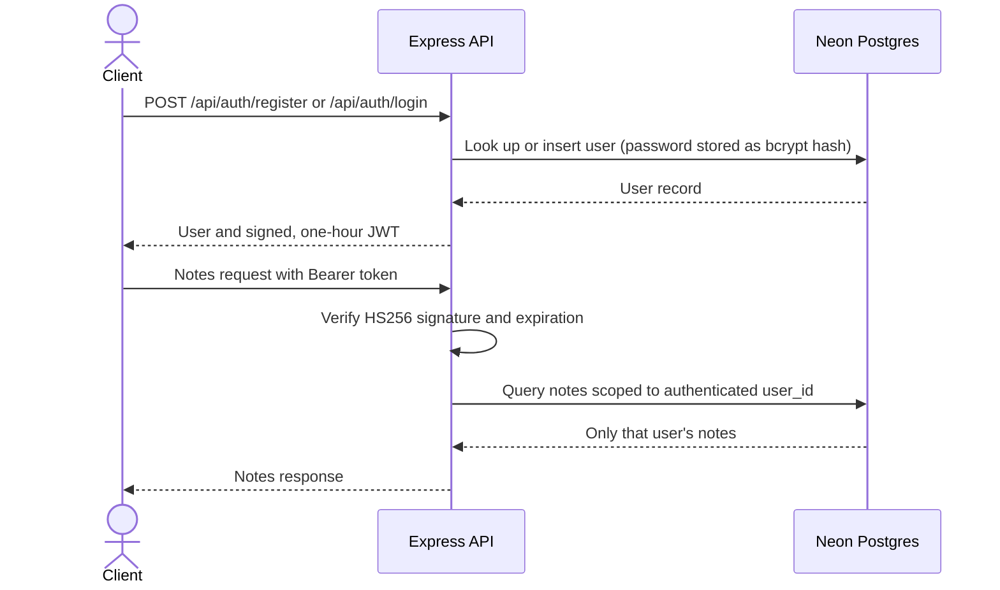

# Notes REST API

A Node.js 20, Express 5 API using Neon Postgres.

## Setup

1. Install Node.js 20 and dependencies:

   ```sh
   npm install
   ```

2. Create a Neon project and copy its PostgreSQL connection string. Create a separate Neon branch for tests rather than pointing tests at the development or production branch. Neon branches are isolated, copy-on-write database branches; writes made by the test suite stay on the test branch. A branch can include the data present at its branch point, so use a sanitized development branch if that data is sensitive.

3. Create `.env` in the project root:

   ```dotenv
   DATABASE_URL=postgresql://<development-branch-connection-string>
   TEST_DATABASE_URL=postgresql://<test-branch-connection-string>
   JWT_SECRET=<at-least-32-random-characters>
   PORT=3000
   ```

   Generate a JWT secret with:

   ```sh
   node -e "console.log(require('node:crypto').randomBytes(32).toString('hex'))"
   ```

   Keep `.env` private; it is ignored by Git. The tests require `TEST_DATABASE_URL` and always use it instead of `DATABASE_URL`.

4. In the Neon SQL Editor, select the development branch and run [`src/db/schema.sql`](src/db/schema.sql). Select the test branch and run the same schema there.

5. Start the server or run the integration tests:

   ```sh
   npm run dev
   npm test
   ```

   The test suite creates uniquely named users and removes them afterward. Never set `TEST_DATABASE_URL` to a production branch.

## Endpoints

All note endpoints require `Authorization: Bearer <token>`. `GET /api/auth/me` also requires a token.

| Method | Path | Purpose | Success |
| --- | --- | --- | --- |
| `GET` | `/api/health` | Check API and database health | `200` |
| `POST` | `/api/auth/register` | Register; validates input and returns a user and token | `201` |
| `POST` | `/api/auth/login` | Log in and return a user and token | `200` |
| `GET` | `/api/auth/me` | Return the authenticated user | `200` |
| `GET` | `/api/notes?q=&tag=&pinned=&page=&limit=` | Search/filter and paginate the user's notes; defaults to page 1 and limit 20 (max 100) | `200` |
| `GET` | `/api/notes/:id` | Get one of the user's notes | `200` |
| `POST` | `/api/notes` | Create a note | `201` |
| `PATCH` | `/api/notes/:id` | Update a note and its `updated_at` timestamp | `200` |
| `DELETE` | `/api/notes/:id` | Delete a note | `204` |

Validation errors return `422`, duplicate registration returns `409`, invalid login returns a generic `401`, and missing or invalid notes return `404`.

## Authentication flow



## Security

- Helmet security headers, an allowlist for local CORS origins, and a 100 KB JSON body limit.
- Zod validation for auth and note inputs; bcrypt password hashing with cost 12.
- HS256 JWTs expire after one hour. Their payload is signed, not encrypted: do not put passwords, hashes, secrets, or sensitive personal data in it.
- Auth routes are rate-limited to 10 requests per IP per 15 minutes.
- SQL uses tagged-template parameters. Note reads, updates, and deletes include the authenticated `user_id`; another user's note is indistinguishable from a missing note and returns `404`.
- Login failures do not reveal whether the email or password was incorrect. Production errors do not expose stack traces or SQL details.

## REST Client requests

Open [`requests.http`](requests.http) with the VS Code REST Client extension and send requests in order so response variables are available. Before sending the expired-token example, generate a signed expired token using the command in that file and replace its placeholder.
